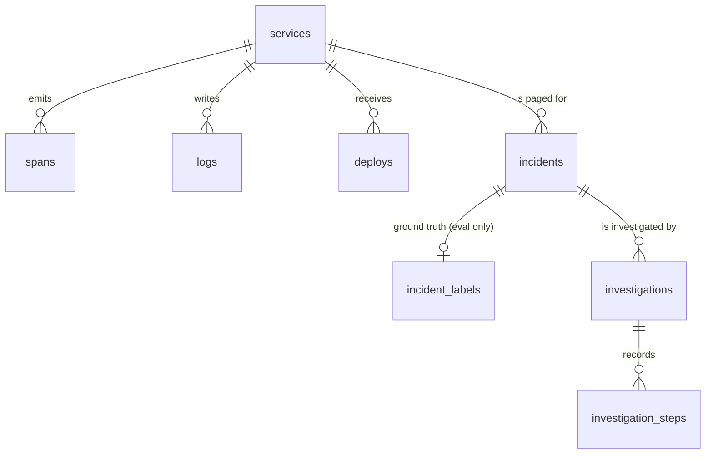

# Schema and index design

The schema is in [investigator/db/models.py](../investigator/db/models.py). It is
created only by Alembic ([migrations/versions/0001_initial_schema.py](../migrations/versions/0001_initial_schema.py)),
and a test checks that the migration and the models never drift apart.

## Tables

| Table | One row per | Notes |
|---|---|---|
| `services` | service | `name` is unique: tools look services up by name. |
| `spans` | OpenTelemetry span | Same shape as LLM Observatory's `spans`: W3C `trace_id` (32 hex) / `span_id` (16 hex), `parent_span_id`, `kind`, `status` (UNSET/OK/ERROR), `attributes` JSON with OTel names (`http.route`, `peer.service`, `db.system`, `gen_ai.system`, `service.version`). |
| `logs` | log line | Optional `trace_id`/`span_id` so logs can be joined to traces. |
| `deploys` | deploy | `version`, `previous_version`, `commit_sha`, `change_summary`. |
| `incidents` | alert | `detected_at` is the moment the alert fired; tools treat it as "now". `service_id` is nullable because a raw alert may not name one. |
| `incident_labels` | labelled incident | Ground truth for the synthetic scenarios. |
| `investigations` | agent run | Status, model, tool calls used, tokens, cost, latency, final report (JSON + markdown). |
| `investigation_steps` | node event or tool call | `seq` within the run, tool name, args, one-line result summary, evidence id, latency. |

## Design decisions

**Ground truth lives in its own table.** `incident_labels` is read only by the
evaluator. No tool queries it, so the agent cannot find the answer by
accident, and real incidents simply have no label row.

**Foreign keys are enforced, with explicit delete behaviour.** Deleting a
service cascades to its telemetry; deleting an incident cascades to its
investigations and steps; deleting a service only nulls `incidents.service_id`,
so incident history is not lost. SQLite ignores foreign keys unless
`PRAGMA foreign_keys=ON`, which the engine sets on every connection.

**Timestamps are always timezone-aware UTC.** Postgres keeps offsets natively,
but SQLite returns naive datetimes, which then fail to compare with aware ones.
A small `UTCDateTime` type normalises on write, re-attaches UTC on read, and
rejects naive datetimes outright (tested).

**JSON is `JSONB` on Postgres and `JSON` on SQLite** (`JSON().with_variant`).
Span attributes are open-ended (OTel has hundreds of keys), so they stay in
JSON rather than becoming columns. If one attribute became a hot filter,
for example `peer.service` for `dependency_health`, the next step would be a
generated column or a Postgres expression index, not a schema rewrite.

**Integer primary keys.** Simpler to read in a demo than UUIDs. Spans also
carry their natural key, `(trace_id, span_id)`, as a unique constraint.

## Indexes, and the query each one serves

Every tool filters by one service and a time window first, so almost every
index leads with `service_id` and ends with the timestamp. That turns "this
service, last 15 minutes" into one contiguous range scan instead of a scan of
all telemetry.

| Index | Query it serves | Why this shape |
|---|---|---|
| `spans (service_id, start_ts)` | `dependency_health`, `query_error_spans`: all spans of one service in a window | Equality column first, range column last, so the window is a single range scan. |
| `spans (service_id, name, start_ts)` | `latency_percentiles`: server spans of one endpoint (`name = 'POST /checkout'`) in the current and baseline windows | Adding `name` before the timestamp skips every other endpoint's spans. The previous index cannot do this: with `name` absent from it, the database would read the whole service window and filter. |
| `spans (service_id, start_ts) WHERE status = 'ERROR'` (partial) | Error lookups: "errors for this service in this window", first error time | Errors are under 1% of spans, so a partial index is tiny and stays in memory. Works on both SQLite and Postgres. |
| `spans UNIQUE (trace_id, span_id)` | Deduplicating re-ingested spans; fetching one trace | The W3C natural key. Also serves `WHERE trace_id = ?` because `trace_id` is the leading column. |
| `logs (service_id, ts)` | `search_logs`: one service in a window | `search_logs` uses `ILIKE '%pattern%'`, which no B-tree can serve, so the index narrows to the service window and the pattern scans only that slice. On Postgres the next step is a `pg_trgm` GIN index on `message`. |
| `logs (trace_id)` | Jumping from a failing span to its log lines | Trace-to-log correlation. |
| `deploys (service_id, deployed_at)` | `recent_deploys` for one service | Same equality-then-range shape. `recent_deploys('all')` reads by time across services; the table is small enough not to need its own index. |
| `incidents (service_id, detected_at)` | "Recent incidents for this service" | For dashboards and dedup. |
| `incidents (status)` | "Open incidents" | Low cardinality, but open incidents are a small subset. |
| `investigations (incident_id, created_at)` | "Latest investigation of this incident" | |
| `investigations (status)` | Finding queued or running work | |
| `investigation_steps UNIQUE (investigation_id, seq)` | Polling and SSE: `WHERE investigation_id = ? AND seq > ? ORDER BY seq` | The uniqueness rule (no two steps share a position) is also exactly the index the stream needs, so one index does both jobs. |

## Indexes deliberately not added

- **`spans (status)` alone.** Low cardinality and never queried without a
  service and a window; the partial index covers it.
- **`spans (service_id, kind, start_ts)`.** `dependency_health` filters on
  `kind = 'CLIENT'`, but about two thirds of all spans are client spans, so the extra
  column saves little and costs a full extra index on the biggest table.
- **JSON attribute indexes.** No query filters on attributes in SQL yet;
  grouping by `peer.service` happens in Python over the already-narrowed
  window.

## Scale notes

The seed creates about 120k spans. On Postgres at production volume the next
steps would be: time-partition `spans` and `logs` by day (every query has a
time range, so partitions get pruned), push percentiles down with
`percentile_cont`, and move retention to dropping old partitions.
